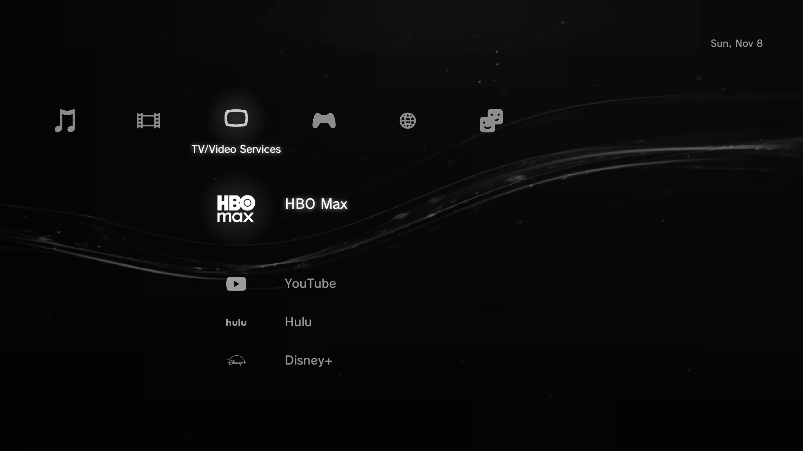
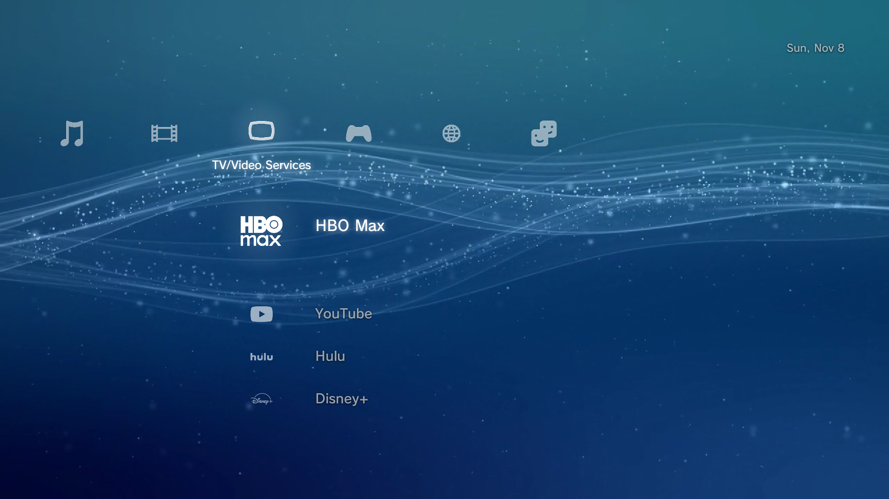
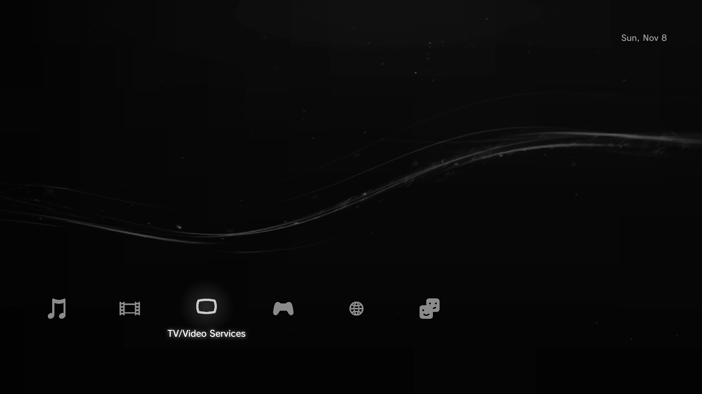

# XMB Home

A PS3-inspired home screen for Fire TV. Moving waves, quiet menus, and your apps in one place.

[Download 1.0.7](https://github.com/kylecoutray/xmb-home/releases/tag/v1.0.7) · [Setup](docs/SETUP.md) · [Build](docs/BUILD.md)



## Make it yours

- **Classic Blue or Dark.** Switch palettes from Menu, with an animated or still wave.
- **A cleaner home.** Monochrome app marks, recent-use ordering, and a small floating date.
- **Room to breathe.** Press Up above the first item to hide the list and lower the category row.
- **The TV essentials.** Installed streaming apps, HDMI inputs, and native settings remain accessible.

Fresh installs start in Classic Blue. The screenshots show a configured TV; streaming apps are installed separately through Amazon Appstore.

## Try it

The launcher runs on an **Android-based Fire TV**. Your Mac, Windows, or Linux computer handles setup.

1. Download and unpack **xmb-home-1.0.7-setup.zip** from [Releases](https://github.com/kylecoutray/xmb-home/releases/tag/v1.0.7).
2. Install Python 3.9+ and [Android Platform Tools](https://developer.android.com/tools/releases/platform-tools). Put `adb` on your PATH, or use `--adb`.
3. Enable ADB Debugging on the TV, find its IP address, and keep both devices on the same network.
4. From the unpacked folder, replace `TV_IP` and run:

```sh
python3 scripts/tv.py install --address TV_IP:5555 --apk xmb-home-1.0.7.apk
```

On Windows, use `py -3` instead of `python3`. Accept the TV's debugging prompt, then run the command again if prompted. Check Home and your apps, then turn ADB Debugging off.

Setup records this TV's previous settings under `.local/state/`. **Keep that folder for rollback.** The default install changes the launcher only; `--cleanup` also applies the small, reversible cleanup described in [Setup](docs/SETUP.md#optional-cleanup).

## Remote controls

| Button | Action |
| --- | --- |
| Left / Right | Change category |
| Up / Down | Move through the list |
| Up above the first item | Fold the list away |
| Down / Select while folded | Open the list without launching an item |
| Select | Open the selected item |
| Home | Open TV/Video Services |
| Menu | Theme, wave, sounds, app order, and TV settings |
| Back | Close a panel, return to the first item, then TV/Video |

<details>
<summary>Classic Blue and folded navigation</summary>





</details>

## Compatibility

Verified on **Insignia NS-40F401NA26, Fire OS 7.7.1.5**. Other Android-based Fire TVs are experimental; this Android APK does not run on Vega OS or as a desktop app. Inputs depend on the TV's own hardware and services.

Fire OS imposes a short launch delay after Home; an early overlay covers the gap. Idle streaming apps retain the TV's screensaver and sleep behavior. YouTube Music opens the official YouTube app, where Music is in the left menu. Friends is currently an informational placeholder.

## Restore or develop

```sh
python3 scripts/tv.py restore --address TV_IP:5555
```

Restore uses the saved state for that TV, preserves unrelated accessibility services, and keeps streaming apps and their data. [Setup and troubleshooting](docs/SETUP.md) covers updates and rollback; [Build](docs/BUILD.md) covers source builds and checks.

## Credits and license

Based on [Homestead v2.1.0](https://github.com/Sarg338/Homestead/tree/63b8d77b8bedc2bf693cca95faa56fb35c1fdf18), with visual references and assets from [XMB TV Home](https://github.com/sanangoyal/XBM-TV-Home/tree/4a4396588da9bfd34897b6c06699dd83929ff3c2).

Code is licensed under [GPL-3.0](LICENSE). Sony-derived assets, fonts, and app marks have separate ownership and notices: see [asset provenance](XMB-ASSETS.md) and [retained notices](assets/xmb/notices/). This fan project is independent of Sony, Amazon, and the app brands.
